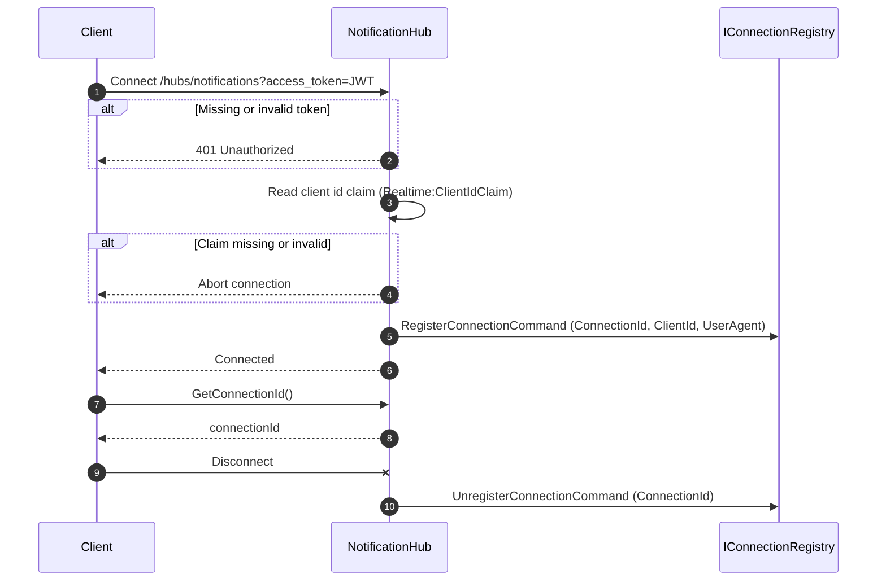
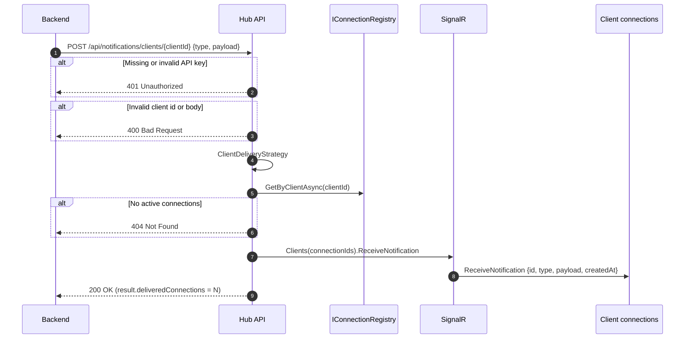
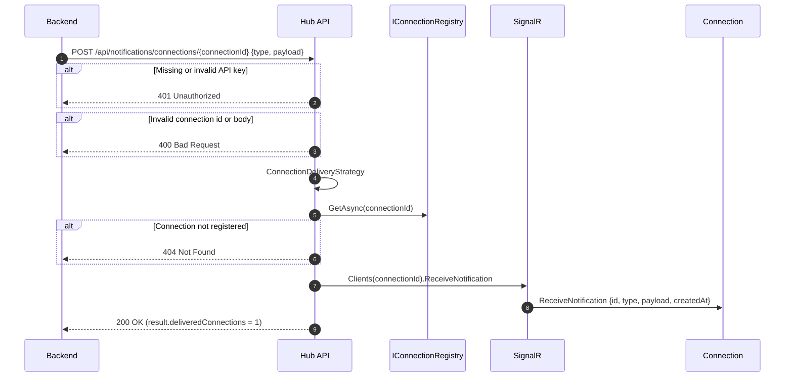
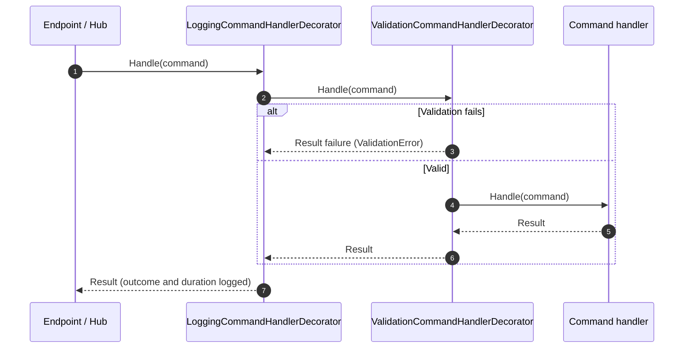

# signalrhub-dotnet

.NET 10 Web API that acts as a **SignalR connection hub**. Clients (web, mobile or services) open a
realtime connection authenticated with a JWT, and backends push notifications through a REST API to
**every connection of a client** or to **one specific connection**.

## Architecture

Clean Architecture, with dependencies pointing inwards:

```
signalrhub-dotnet
├── .vscode/                     Build/test/watch tasks and debug configuration
├── SignalRHub.App/              Minimal API endpoints, JWT + API key authentication,
│                                PetitionResponse envelope, global exception handler, OpenAPI + Swagger UI,
│                                OpenTelemetry metrics exported to Prometheus
├── SignalRHub.Application/      Use cases (commands/queries), FluentValidation validators,
│                                delivery strategies, handler decorators, business metrics (HubMetrics),
│                                ports: IConnectionRegistry, INotificationDispatcher
├── SignalRHub.Domain/           Value objects (ClientId, ConnectionId), ClientConnection,
│                                Notification, NotificationTarget, Result pattern, error catalogs
├── SignalRHub.Infrastructure/   SignalR hub and dispatcher adapter, in-memory connection registry
├── SignalRHub.Test/             xUnit + NSubstitute + Shouldly, one folder per layer
├── .dockerignore
├── .gitignore
├── docker-compose.yml           API container with local defaults
├── Dockerfile
├── SignalRHub.slnx
└── README.md
```

Each project declares its namespaces in a `GlobalUsings.cs`.

Design patterns:

- **Ports and adapters**: the application layer defines `IConnectionRegistry` and
  `INotificationDispatcher`; the infrastructure layer implements them.
- **Repository**: `IConnectionRegistry`, implemented by `InMemoryConnectionRegistry`.
- **Strategy + Factory**: `INotificationDeliveryStrategy` (`ClientDeliveryStrategy`,
  `ConnectionDeliveryStrategy`), selected by `DeliveryStrategyResolver` from the `NotificationTarget`.
  A new kind of target (group, broadcast, ...) is a new `NotificationTarget` plus a new strategy,
  without touching the handler.
- **Decorator**: `ValidationCommandHandlerDecorator` and `LoggingCommandHandlerDecorator` wrap every
  command handler (registered with Scrutor).
- **Lightweight CQRS**: own `ICommandHandler<,>` / `IQueryHandler<,>` interfaces, no MediatR.
- **Result**: business errors are values (`Result<T>`), mapped to a `PetitionResponse` by the API.
- **Adapter**: `SignalRNotificationDispatcher` turns the dispatcher port into SignalR calls.
- Strongly typed hub (`Hub<INotificationClient>`), Options (validated on start), DI extension methods.

## Connection model

| Concept            | Description                                                                         |
|--------------------|-------------------------------------------------------------------------------------|
| `ClientId`         | Owner of the connections (tenant, user or application). Read from a JWT claim       |
| `ConnectionId`     | One SignalR connection (a browser tab, device or service instance)                  |
| `ClientConnection` | ConnectionId, ClientId, ConnectedAt, UserAgent                                      |

A client can hold any number of connections at the same time. Connections are registered when they
open and removed when they close, so the registry only holds active connections. Both ids are
trimmed and limited to 128 characters.

## Hub

The hub is mapped at `/hubs/notifications` and requires a JWT. Browsers send it in the
`access_token` query string, which SignalR does automatically through `accessTokenFactory`.
Connections without a valid token get `401`, and connections whose token has no client id claim
are aborted.

| Direction       | Method                | Description                                                     |
|-----------------|-----------------------|-----------------------------------------------------------------|
| Client → server | `GetConnectionId()`   | Returns the id of the current connection                        |
| Server → client | `ReceiveNotification` | Delivers a notification `{ id, type, payload, createdAt }`       |

```js
import * as signalR from "@microsoft/signalr";

const connection = new signalR.HubConnectionBuilder()
  .withUrl("http://localhost:5108/hubs/notifications", { accessTokenFactory: () => token })
  .withAutomaticReconnect()
  .build();

connection.on("ReceiveNotification", notification => console.log(notification.type, notification.payload));
await connection.start();
const connectionId = await connection.invoke("GetConnectionId");
```

## Endpoints

Every `/api` endpoint requires the `X-Api-Key` header with one of the keys in `ApiKeys:Keys`.

| Method | Route                                          | Description                                                  |
|--------|------------------------------------------------|--------------------------------------------------------------|
| POST   | `/api/notifications/clients/{clientId}`        | Sends `{ type, payload }` to every connection of the client  |
| POST   | `/api/notifications/connections/{connectionId}` | Sends `{ type, payload }` to one connection                  |
| GET    | `/api/clients/{clientId}/connections`          | Lists the active connections of the client                   |
| POST   | `/dev/token`                                   | Issues a client JWT for `{ clientId }` (Development only)    |
| GET    | `/health`                                      | Liveness check                                               |

`type` is required (up to 100 characters) and names the event, for example `order.updated`.
`payload` is optional and can be any JSON value; clients receive it as is.

### Response format

Every response, successful or not, is a `PetitionResponse`, and its `statusCode` is also the HTTP
status code of the response:

```json
{
  "success": true,
  "message": "Notification sent successfully.",
  "module": "NotificationService",
  "result": {
    "notificationId": "01a19daf-5c78-7f95-b34f-9617811e77f0",
    "deliveredConnections": 2,
    "sentAt": "2026-11-02T19:14:37.8163599+00:00"
  },
  "statusCode": 200
}
```

| Property     | Description                                                                                   |
|--------------|-----------------------------------------------------------------------------------------------|
| `success`    | Whether the petition was processed successfully                                               |
| `message`    | Message describing the processing                                                             |
| `module`     | Module or service that generated the message: `NotificationService`, `ConnectionService`, `TokenService`, `RequestValidation` (malformed or missing body), `GlobalExceptionHandler` (unexpected errors), `HealthCheck` or `Api` (missing API key, unknown route, method or media type) |
| `result`     | Returned information, or `null` when there is none. On validation failures it holds `errors`, grouped by field |
| `statusCode` | HTTP status code                                                                              |

`result` of each endpoint:

| Endpoint                                   | `result`                                                              |
|--------------------------------------------|-----------------------------------------------------------------------|
| `POST /api/notifications/...`              | `{ notificationId, deliveredConnections, sentAt }`                    |
| `GET /api/clients/{clientId}/connections`  | `[{ connectionId, clientId, connectedAt, userAgent }]` (empty when the client has no connections) |
| `POST /dev/token`                          | `{ accessToken, expiresAt }`                                          |
| `GET /health`                              | `{ status, checks }`                                                  |

A validation failure:

```json
{
  "success": false,
  "message": "One or more validation errors occurred.",
  "module": "NotificationService",
  "result": { "errors": { "Type": ["'Type' must not be empty."] } },
  "statusCode": 400
}
```

Status codes: `200` success, `400` validation (invalid route value, body field, or a malformed or
missing body), `401` missing or invalid API key, `404` the client has no active connections or the
connection does not exist, `405`/`415` unsupported method or media type, `500` unexpected error.

## Sequence diagrams

Every HTTP response is a `PetitionResponse` whose `statusCode` is shown on the arrows back to the
backend.

### Connection lifecycle



### Send to a client

`POST /api/notifications/clients/{clientId}`



### Send to a connection

`POST /api/notifications/connections/{connectionId}`



### Command pipeline

Every command goes through the decorators before reaching its handler:



## Health checks

| Endpoint      | Checks                                 | Used by                     |
|---------------|----------------------------------------|-----------------------------|
| `GET /health` | The API is running (no dependencies)   | Docker healthcheck          |

It answers with a `PetitionResponse` (module `HealthCheck`) whose `result` holds the overall status:
`200` when healthy, `503` when unhealthy. The Docker healthcheck calls it with `curl` (installed in the image)
every 30 seconds. Health requests are excluded from the HTTP metrics.

## Metrics

The API exports OpenTelemetry metrics in the Prometheus format at `GET /metrics`, served **only on a
dedicated port** that is not published, so Prometheus scrapes it from the private network and Grafana
reads it from Prometheus.

| Port   | Serves                                   | Exposure                                         |
|--------|------------------------------------------|--------------------------------------------------|
| `8080` | API, hub and `/health`                   | Public                                           |
| `9464` | `/metrics` only (anything else is `404`) | Internal: `expose` in Docker, never `ports`      |

`/metrics` is not reachable through `8080`: the scraping endpoint checks the local port of the
connection, not the `Host` header, so it cannot be forged through the public port. Locally
(Development) the metrics port is `9465`, so it does not collide with other services that use the
OpenTelemetry default `9464`.

### Hub metrics

Meter `SignalRHub` (`HubMetrics`, application layer):

| Prometheus metric                                     | Type      | Labels              | Description                                                   |
|-------------------------------------------------------|-----------|---------------------|---------------------------------------------------------------|
| `signalrhub_connections_active`                       | Gauge     |                     | Connections currently registered                              |
| `signalrhub_clients_active`                           | Gauge     |                     | Clients with at least one connection                          |
| `signalrhub_connections_opened_total`                 | Counter   |                     | Connections registered                                        |
| `signalrhub_connections_closed_total`                 | Counter   |                     | Connections removed                                           |
| `signalrhub_notifications_sent_total`                 | Counter   | `target`, `outcome` | Notification requests; `target`: `client`/`connection`, `outcome`: `delivered`/`not_found` |
| `signalrhub_notifications_recipients_total`           | Counter   | `target`            | Connections notifications were delivered to                   |
| `signalrhub_notifications_dispatch_duration_seconds`  | Histogram | `target`            | Time SignalR took to dispatch a notification                  |

Labels are low cardinality on purpose: client ids, connection ids and notification types are not
labels. The active gauges read a snapshot of the registry on each scrape, so they cannot drift.

### Built-in metrics

| Meter                                   | Main metrics                                                                                    |
|-----------------------------------------|-------------------------------------------------------------------------------------------------|
| `Microsoft.AspNetCore.Hosting`          | `http_server_request_duration_seconds` (by route, method, status), `http_server_active_requests` |
| `Microsoft.AspNetCore.Http.Connections` | `signalr_server_active_connections`, `signalr_server_connection_duration_seconds` (by transport)  |
| `Microsoft.AspNetCore.Server.Kestrel`   | `kestrel_active_connections`, `kestrel_connection_duration_seconds`, `kestrel_queued_connections` |
| `System.Runtime`                        | `dotnet_gc_*`, `dotnet_process_cpu_time_seconds_total`, `dotnet_process_memory_working_set_bytes`, `dotnet_thread_pool_*` |

Every series carries `target_info{service_name="signalrhub"}`. Requests to `/metrics` and `/health`
are not recorded in the HTTP metrics.

### Prometheus

```yaml
scrape_configs:
  - job_name: signalrhub
    scrape_interval: 15s
    static_configs:
      - targets: ["signalrhub:9464"]
```

Prometheus must share a Docker network with the API to reach `signalrhub:9464`.

### Grafana queries

| Panel                                   | PromQL                                                                                                   |
|-----------------------------------------|----------------------------------------------------------------------------------------------------------|
| Active connections / clients            | `signalrhub_connections_active`, `signalrhub_clients_active`                                             |
| Notifications per second                | `sum by (target, outcome) (rate(signalrhub_notifications_sent_total[5m]))`                               |
| Not found ratio                         | `sum(rate(signalrhub_notifications_sent_total{outcome="not_found"}[5m])) / sum(rate(signalrhub_notifications_sent_total[5m]))` |
| Connections reached per second          | `sum by (target) (rate(signalrhub_notifications_recipients_total[5m]))`                                  |
| Dispatch latency p95                    | `histogram_quantile(0.95, sum by (le, target) (rate(signalrhub_notifications_dispatch_duration_seconds_bucket[5m])))` |
| HTTP latency p95 by route               | `histogram_quantile(0.95, sum by (le, http_route) (rate(http_server_request_duration_seconds_bucket[5m])))` |
| HTTP errors per second                  | `sum by (http_route, http_response_status_code) (rate(http_server_request_duration_seconds_count{http_response_status_code=~"5.."}[5m]))` |
| Memory / CPU                            | `dotnet_process_memory_working_set_bytes`, `rate(dotnet_process_cpu_time_seconds_total[5m])`            |

## Running with Docker

Builds the image and starts the API on port `8080`, with the metrics on the internal port `9464`:

```bash
docker compose up -d --build
```

The image runs in the `Production` environment, so Swagger UI and `/dev/token` are disabled. Set
`ASPNETCORE_ENVIRONMENT=Development` to enable them.

| Variable                 | Default                                         | Setting               |
|--------------------------|-------------------------------------------------|-----------------------|
| `JWT_SIGNING_KEY`        | `local-docker-signing-key-change-me-0123456789` | `Jwt:SigningKey`      |
| `PUBLISHER_API_KEY`      | `docker-api-key-change-me`                      | `ApiKeys:Keys:0`      |
| `ASPNETCORE_ENVIRONMENT` | `Production`                                    | Hosting environment   |

The defaults are only meant for local runs; replace them in any shared environment.

## Running locally

```bash
dotnet run --project SignalRHub.App
```

Or use the `SignalRHub.App` debug configuration in VS Code. In the Development environment Swagger
UI is available at `http://localhost:5108/swagger`, metrics at `http://localhost:9465/metrics`, the API key is `dev-api-key-change-me`, and a
client token can be issued with:

```bash
curl -X POST http://localhost:5108/dev/token -H "Content-Type: application/json" -d '{"clientId":"client-1"}'
```

Then send a notification:

```bash
curl -X POST http://localhost:5108/api/notifications/clients/client-1 \
  -H "X-Api-Key: dev-api-key-change-me" -H "Content-Type: application/json" \
  -d '{"type":"order.updated","payload":{"orderId":7}}'
```

## Configuration

`appsettings.json`:

- `Realtime`: `HubPath` (route of the hub, `/hubs/notifications`) and `ClientIdClaim` (JWT claim
  that holds the client id, `sub`).
- `Jwt`: `Issuer`, `Audience` and `SigningKey` (HMAC-SHA256, at least 32 characters) used to
  validate client tokens. `SigningKey` is empty in `appsettings.json` and must be provided per
  environment; `appsettings.Development.json` holds a development key.
- `ApiKeys`: `HeaderName` (`X-Api-Key`) and `Keys`, the keys of the backends allowed to send
  notifications. Keys are compared in constant time.
- `Cors:AllowedOrigins`: browser origins allowed to connect to the hub.
- `Metrics`: `Port` (`9464`, `9465` in `appsettings.Development.json`) and `Path` (`/metrics`) of the
  Prometheus scraping endpoint. The server must also listen on that port (`ASPNETCORE_HTTP_PORTS`
  in the Dockerfile, `applicationUrl` in `launchSettings.json`).

The API does not start when `Jwt`, `ApiKeys` or `Metrics` are missing or invalid. Environment variables
override any value using `__` as separator, for example `Jwt__SigningKey` or `ApiKeys__Keys__0`.

## Scaling out

`InMemoryConnectionRegistry` only knows the connections of its own instance. To run several
instances, implement `IConnectionRegistry` on a shared store such as Redis and add the SignalR Redis
backplane (`AddStackExchangeRedis`), so notifications reach connections held by other instances.

## Tests

```bash
dotnet test
```
